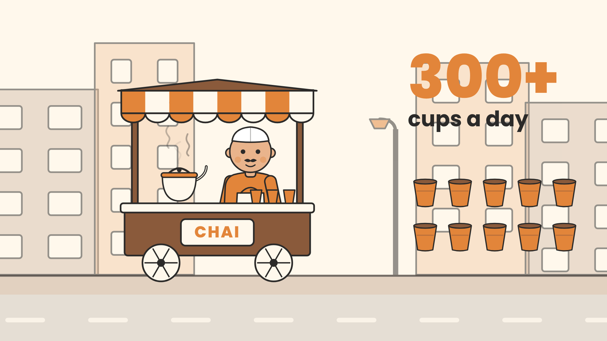
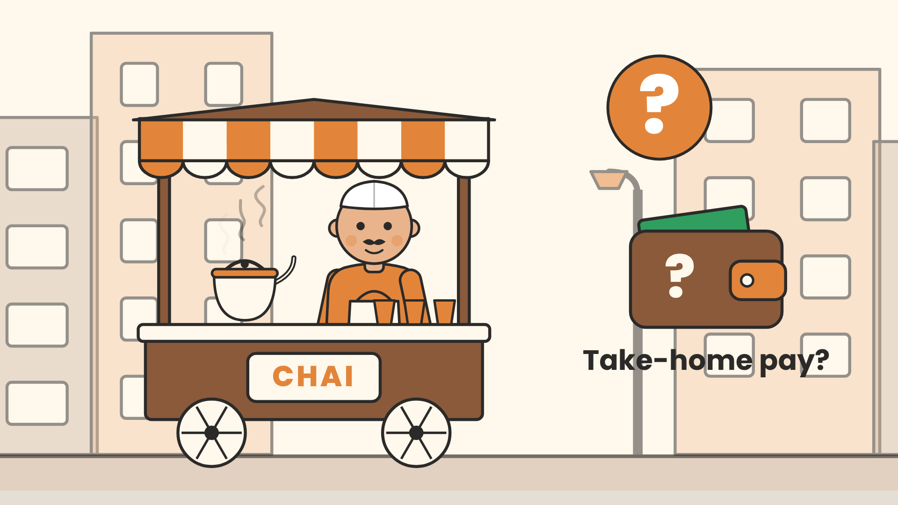
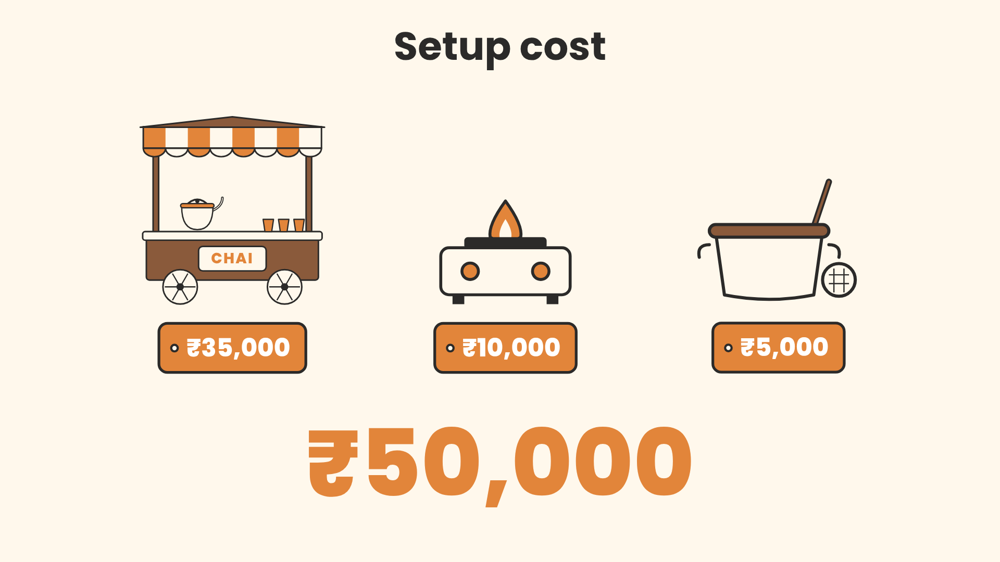
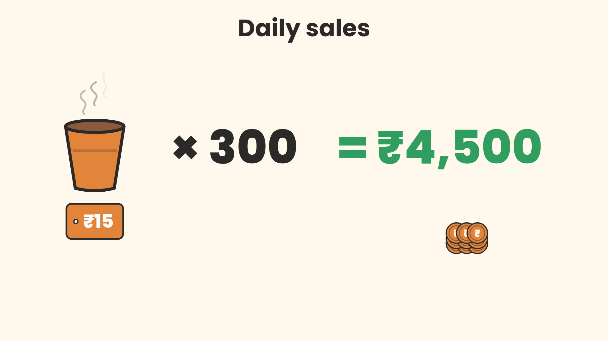
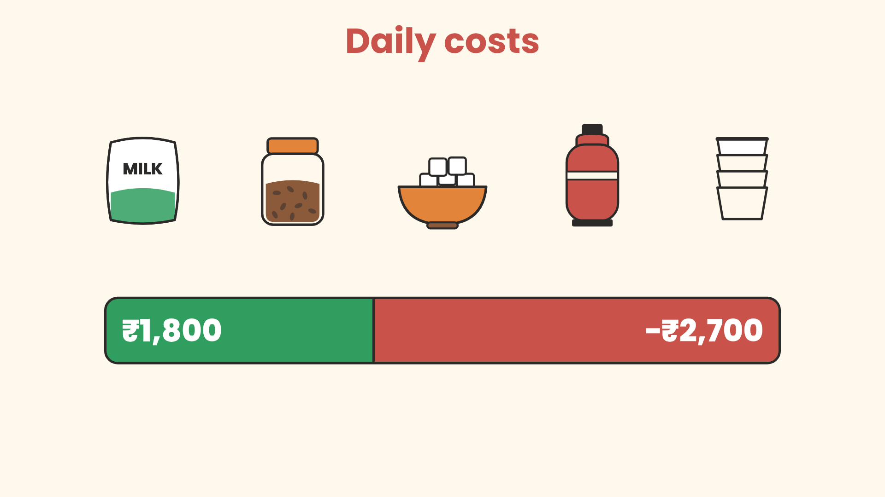
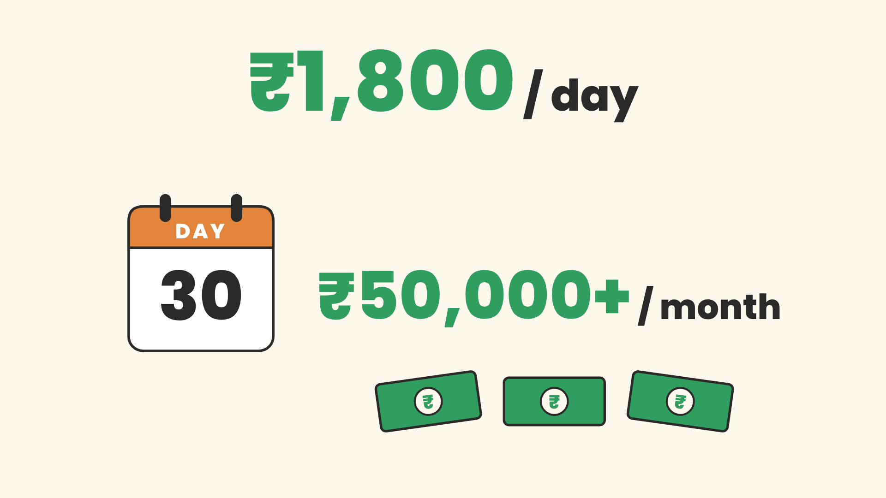
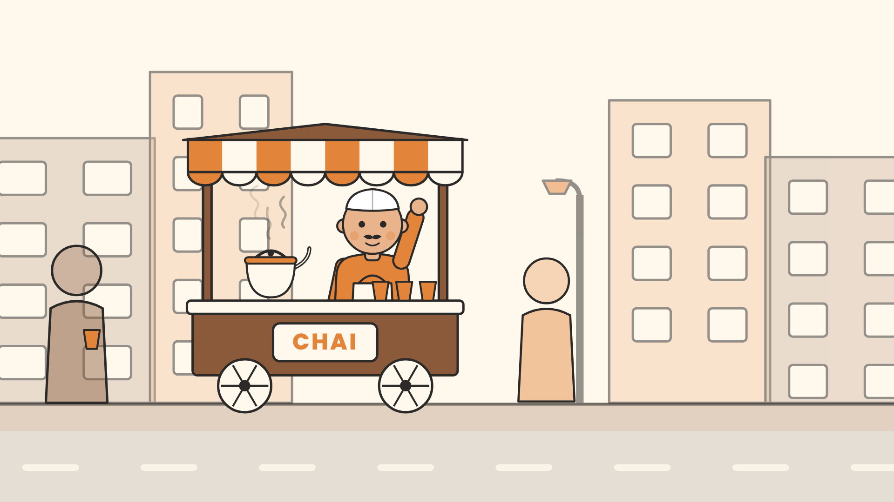

# Storyboard: Chai Stall Explainer

Status: **approved and rendered** to `out/chai-stall-explainer.mp4`.

- Format: 1920 x 1080, 30 fps, H.264 + AAC
- Voiceover: your file `Chai_Story.mp3` (35.3 s), copied to `public/audio/voiceover.mp3`
- Timings: taken from your audio by forced alignment, not guessed (`work/words.json`)
- **Length: 36.1 s** (speech ends at 35.1 s, plus a 1 s hold on the outro)
- Style: cream background, flat vector, 5 px charcoal outline on everything, Poppins for text
- Palette: cream `#FFF8EC`, charcoal `#2B2A29`, chai orange `#E2853A`, brown `#8A5A3B`, profit green `#2F9E5E`, cost red `#C9534A` (plus one skin tone)
- Transitions: clean cuts in the pause between sentences
- Every scene has a slow 1.00 to 1.05 zoom, so no frame sits fully still
- Music: none (no track in `public/music/`)
- SFX: none yet (see the questions at the end)

The thumbnails show the **last frame of each scene**, once everything has appeared.

---

### Scene 1: Hook (0.00 to 4.25 s)

| | |
|---|---|
| **VO** | "This tiny chai stall sells over 300 cups a day." |
| **On screen** | Street-corner backdrop. Chai cart with seller pops in on frame 1. Kettle steams. 10 kulhads pop in one after another. `300+` counts up from 0 with "cups a day" underneath. |
| **Sync** | Counter starts on "three" (2.10 s) |
| **Motion** | PopIn (cart), IdleBob + blink (seller), Steam, CountUp, SlowZoom 1.00 to 1.05 |

### Scene 2: Question (4.25 to 7.45 s)

| | |
|---|---|
| **VO** | "But how much does the owner actually take home?" |
| **On screen** | Same stall. Camera pushes in toward the seller (1.05 to 1.30). A big `?` badge pops in, then a wallet with `?` and the label "Take-home pay?". |
| **Sync** | `?` on "how" (4.80 s), wallet on "take" (6.46 s) |

### Scene 3: Setup cost (7.45 to 13.56 s)

| | |
|---|---|
| **VO** | "Setting up costs around ₹50,000: a cart, a stove, and some utensils." |
| **On screen** | Title "Setup cost". Big `₹50,000` counts up. Cart, stove and utensils pop in one by one, each with a price tag (₹35,000 / ₹10,000 / ₹5,000). |
| **Sync** | Total on "fifty" (8.96 s), cart on "cart" (10.87 s), stove on "stove" (11.55 s), utensils on "utensils" (12.52 s) |
| **QA change** | Dashed empty slots with "₹ ?" tags fill the frame until each item is spoken, so the scene never looks empty. |
| **Note** | In your brief the items appear first and the total comes after. The narration says "₹50,000" **before** naming the items, so to stay on the words, the total appears first here. |

### Scene 4: Revenue (13.56 to 20.15 s)

| | |
|---|---|
| **VO** | "Each cup sells for ₹15, so daily sales reach ₹4,500." |
| **On screen** | Title "Daily sales". Steaming kulhad with a `₹15` tag, then `× 300` slides up, then `= ₹4,500` slides in from the right in green and counts up. 9 coins arc in from the top right into a pile. |
| **Sync** | Cup on "each" (13.89 s), `× 300` on "so" (16.32 s), `= ₹4,500` + coins on "four" (17.78 s) |

### Scene 5: Costs (20.15 to 26.69 s)

| | |
|---|---|
| **VO** | "Milk, tea leaves, sugar, gas and cups eat up about ₹2,700." |
| **On screen** | Title "Daily costs" in red. Milk packet, tea jar, sugar bowl, gas cylinder and stacked cups pop in on each word. A green `₹4,500` bar then gets eaten by a red `−₹2,700` segment, leaving `₹1,800`. |
| **Sync** | milk 20.43, tea 21.08, sugar 21.86, gas 22.57, cups 23.17, red drain on "two" 24.40 s |

### Scene 6: Profit (26.69 to 33.14 s)

| | |
|---|---|
| **VO** | "That leaves roughly ₹1,800 a day, or over ₹50,000 a month." |
| **On screen** | Green `₹1,800 / day` counts up. A calendar flips from day 1 to day 30. Then `₹50,000+ / month` pops in, with three rupee notes. |
| **Sync** | `₹1,800` on "one" (27.78 s), calendar appears on "day" (29.63 s) and flips from "or" (30.30 s), monthly figure on "fifty" (30.96 s) |

### Scene 7: Outro (33.14 to 36.12 s)

| | |
|---|---|
| **VO** | "Not bad for a cart on the corner." |
| **On screen** | Back on the street. The camera pulls out (1.30 to 1.00) to show the cart on the corner with two customers. The seller waves. Holds 1 s after the last word. |
| **Sync** | Wave starts on "bad" (33.55 s) |
